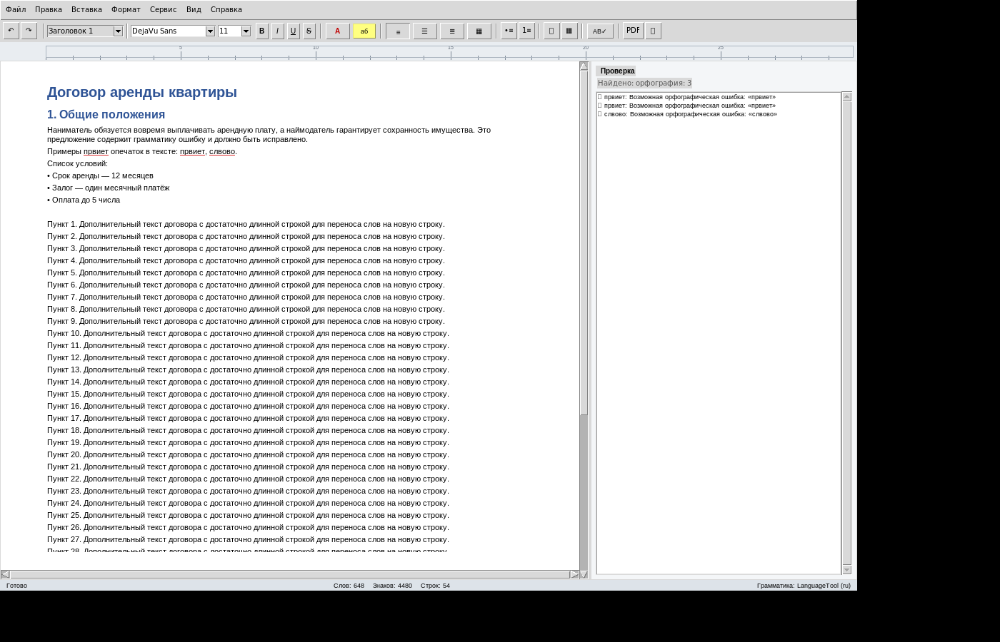
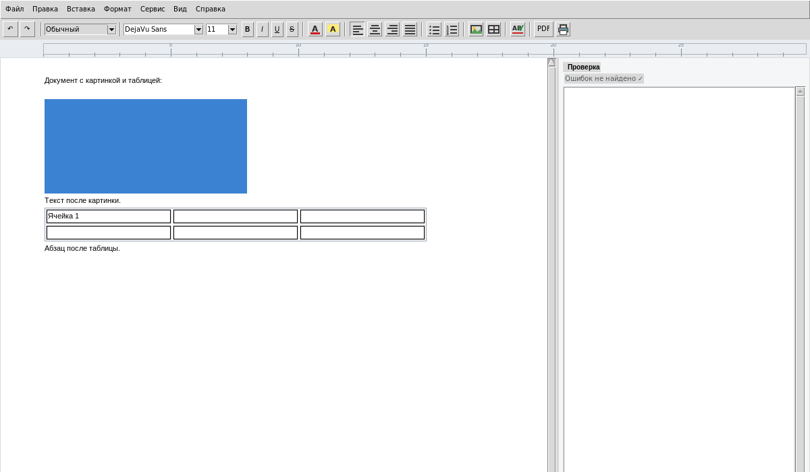
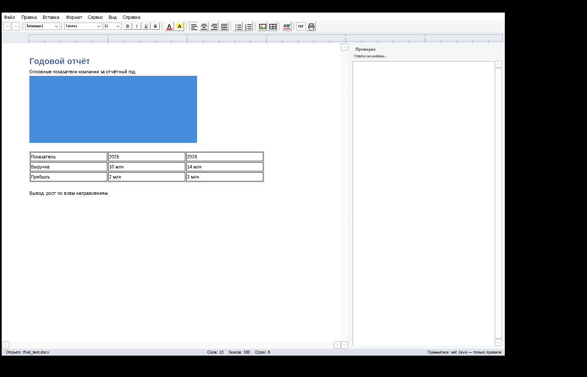

# WordFree — бесплатный текстовый редактор (аналог MS Word)

Полнофункциональный текстовый редактор с **проверкой орфографии и грамматики**,
работой с **`.docx`**, экспортом в **PDF**, таблицами, картинками и стилями.
Бесплатно, без подписок и лицензий.

> Честно: это не копия Microsoft Word «один в один» — Word это миллионы строк кода.
> Это самостоятельный редактор с главными функциями Word, которого хватает для
> повседневной работы с документами. И всё — бесплатно.

---

## Возможности

**Текст и форматирование**
- шрифты, кегль, **жирный / курсив / подчёркнутый / зачёркнутый** (Ctrl+B/I/U)
- цвет шрифта, выделение фона
- выравнивание: слева / центр / справа / по ширине (Ctrl+E/L/R/J)
- стили заголовков 1–3 (в цвете Word), обычный текст
- маркированные и нумерованные списки
- отступы, межстрочный интервал, интервал после абзаца (диалог «Абзац»)
- разрыв страницы (Ctrl+Enter), мягкий перенос (Shift+Enter)
- отмена/повтор (Ctrl+Z/Y), вставка даты (F5)

**Проверка текста**
- **Орфография**: полные словари **русского** и **английского** языка
  (hunspell, 146 000+ словоформ) — работает офлайн
  - красное подчёркивание ошибок, варианты замены по правой кнопке мыши
  - «Игнорировать», «Добавить в словарь» (словарь пользователя сохраняется)
- **Грамматика**: движок **LanguageTool** (нужна Java 17+) — согласование,
  повторы, пунктуация, двойные предлоги и т.п.; плюс **встроенные правила**,
  которые работают всегда даже без Java
- панель «Проверка» сок списка ошибок и переходом к ним
- **F7** — пошаговая проверка «Заменить / Игнорировать / В словарь»
- вкл/выкл проверки и выбор языка в меню «Сервис»

**Документы**
- Открытие/сохранение **`.docx`** (совместим с MS Word, LibreOffice, Google Docs)
- сохранение в `.txt` (UTF-8)
- экспорт в **PDF** с кириллицей и картинками
- **печать** (через системный просмотр PDF)
- параметры страницы (поля, A4)
- таблицы (вставка, строки/столбцы, Tab между ячейками)
- картинки PNG/JPG/GIF/BMP
- **найти/заменить** (Ctrl+F / Ctrl+H), целые слова, регистр
- счётчик слов/знаков/строк в строке состояния, линейка

---

## Запуск

### Windows — готовый `.exe`
Скачайте `WordFree.exe` и запустите двойным щелчком. Установка не нужна.

*Для полной проверки грамматики* (опционально): установите
[Java 17+](https://adoptium.net/) — при первом запуске LanguageTool скачается
один раз (~260 МБ) в `%APPDATA%\WordFree\LanguageTool`. Без Java работают
орфография и встроенные правила грамматики.

Файлы пользователя (настройки, словарь):
`%APPDATA%\WordFree\` (Windows) / `~/.config/WordFree/` (Linux).

### Linux / запуск из исходников
```bash
pip install -r requirements.txt         # python-docx, spylls, Pillow, reportlab, language_tool_python
python3 main.py [документ.docx]
```
Для грамматики нужна Java 17+ (`sudo apt install default-jre`).

---

## Скриншоты

| | |
|---|---|
|  |  |
|  | |

---

## Сборка `WordFree.exe` самостоятельно

**На Windows** (просто так):
1. Поставьте [Python 3.11+](https://www.python.org/downloads/) (галка *Add to PATH*)
2. Запустите `build_windows.bat`
3. Готовый файл — `dist\WordFree.exe`

**На Linux** (через Wine):
```bash
sudo apt install wine64 wine32:i386
wine python-3.11.9-amd64.exe /quiet PrependPath=1
wine cmd /c "pip install -r requirements-win.txt"
# затем build_windows.bat или pyinstaller-команда из него
```

---

## Горячие клавиши

| Клавиша | Действие |
|---|---|
| Ctrl+B / I / U | жирный / курсив / подчёркнутый |
| Ctrl+E / L / R / J | выравнивание: центр / лево / право / по ширине |
| Ctrl+] / Ctrl+[ | увеличить / уменьшить кегль |
| Ctrl+F / Ctrl+H | найти / заменить |
| Ctrl+S / Ctrl+O / Ctrl+N | сохранить / открыть / новый |
| Ctrl+P | печать |
| Ctrl+D | диалог «Шрифт» |
| F7 | проверка орфографии и грамматики |
| F5 | вставить дату |
| Ctrl+Enter | разрыв страницы |
| Ctrl+Z / Ctrl+Y | отмена / повтор |
| Shift+Enter | перенос строки без нового абзаца |

---

## Известные ограничения

- «По ширине» в редакторе отображается как выравнивание по левому краю
  (Tk не умеет полное выравнивание) — но в `.docx`/PDF сохраняется корректно
- таблицы: однострочные ячейки, без объединения ячеек
- колонки, оглавление, сноски, поля Word — не реализованы
- масштабирование вида (zoom) отсутствует
- полнотекстовая вёрстка «как на печати» (постраничный вид) — упрощённая

---

## Технологии и лицензии

| Компонент | Лицензия |
|---|---|
| [LanguageTool](https://languagetool.org/) — грамматика | LGPL 2.1+ |
| [spylls](https://spylls.readthedocs.io/) — hunspell на Python | BSD-2 |
| Словари [LibreOffice dictionaries](https://github.com/LibreOffice/dictionaries) (ru_RU, en_US) | см. репозиторий (GPL/LGPL/MPL, русский словарь — GPL) |
| [python-docx](https://python-docx.readthedocs.io/) | MIT |
| [ReportLab](https://www.reportlab.com/) (PDF) | BSD |
| [Pillow](https://python-pillow.org/) | MIT-CMU |
| [pyspellchecker](https://github.com/barrust/spellchecker) | MIT |
| Шрифты [DejaVu](https://dejavu-fonts.github.io/) | Bitstream Vera / Arev |

Словари языков распространяются вместе с программой в соответствии с их
лицензиями (тексты лицензий — в исходниках проектов).
Сам код WordFree можно свободно использовать и модифицировать.
